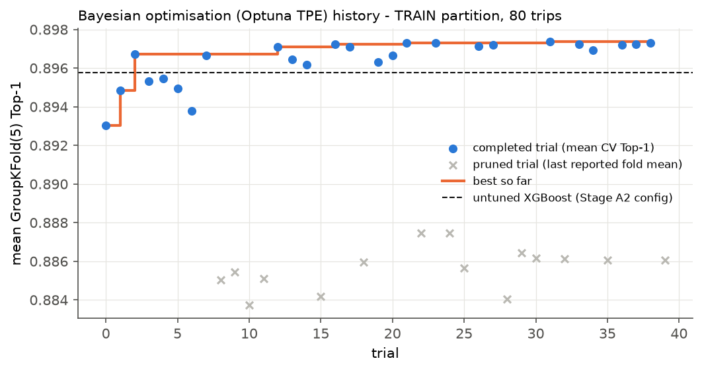
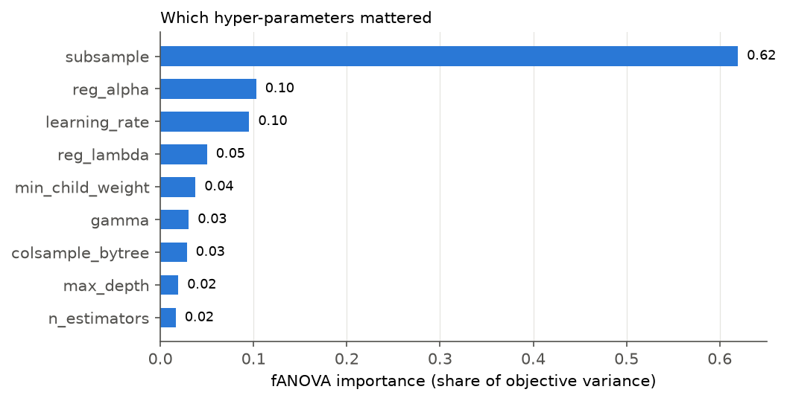
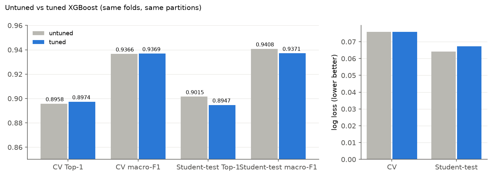

<!-- Draft of report §4 written by Account A from results/bayes_opt (all numbers from the files). Aditya: use/merge as you like, then delete this file. -->

## 4. Bayesian hyperparameter optimisation

We tuned the selected model, XGBoost, with **Optuna** (`scripts/05_bayes_opt.py`). Optuna's TPE sampler (Tree-structured
Parzen Estimator) is a Bayesian optimiser. It fits density models of good and bad trials and proposes the next
configuration where the expected improvement is highest. The full search record is in `results/bayes_opt/study.db`
(Optuna SQLite storage) and `results/bayes_opt/trials.csv`.

**Q1–Q2: Hyperparameters and ranges.** We chose these nine because Figure 20 shows overfitting, and they control
model capacity, randomisation and regularisation.

| Hyperparameter | Range / distribution | Why |
|---|---|---|
| n_estimators | int 100–800, log-uniform | Number of boosting rounds (validation loss rose after round 120) |
| learning_rate | 0.01–0.3, log-uniform | Shrinkage; trades off against n_estimators |
| max_depth | int 3–12 | Tree complexity (the untuned value was 8) |
| min_child_weight | 1–200, log-uniform | Minimum Hessian per leaf, which stops leaves fitting a few candidates |
| subsample | 0.5–1.0, uniform | Row sampling per tree |
| colsample_bytree | 0.4–1.0, uniform | Feature sampling per tree |
| gamma | 0–5, uniform | Minimum loss reduction needed to split |
| reg_lambda | 1e-3–50, log-uniform | L2 penalty on leaf weights |
| reg_alpha | 1e-3–10, log-uniform | L1 penalty on leaf weights |

**Q3: Objective.** Maximise the **mean observation-level Top-1 accuracy over the same GroupKFold(5) split of the 80
train trips** that we used in §3, so all trips of one vehicle stay in one fold. Top-1 is our primary metric,
because the route and the HMM emissions depend on choosing the right candidate for each observation. CV
macro-F1, log loss and the fold standard deviation are stored as attributes of every trial. Neither the
student-test nor the evaluator partition was used in the search.

**Q4: Trials and cost.** We ran 40 trials: TPE with seed 42 and 10 random start-up trials, plus a median pruner
that stops a trial after any fold where its running mean falls below the median of earlier trials. 25 trials
completed and 15 were pruned. The search took 1,961 s (about 33 min) of wall-clock time on an 8-core M-series
laptop. A completed trial took 35–85 s, and pruned trials stopped after 1–2 folds.

*Figure 24 – Optuna optimisation history [train]. Blue dots are completed trials (mean 5-fold Top-1), grey crosses
are pruned trials (mean of the folds evaluated before pruning, mostly fold 0, the hardest fold), the orange line is
the best value so far, and the dashed line is the untuned configuration from §3.*

**Q5: Best values (trial 31).** n_estimators **410**, learning_rate **0.0238**, max_depth **6**,
min_child_weight **9.88**, subsample **0.758**, colsample_bytree **0.409**, gamma **4.85**, reg_lambda **0.177**,
reg_alpha **0.0035**. The search moved to fewer, shallower and more randomised trees, with a high minimum split
gain (gamma). fANOVA importance (Figure 25) shows that **subsample** accounts for 62 % of the objective's
variance, followed by reg_alpha (10 %) and learning_rate (10 %). Completed trials span only 0.8930–0.8974 Top-1,
so the problem is not very sensitive to XGBoost settings once the features are fixed.

*Figure 25 – fANOVA hyperparameter importance over the completed trials [train].*

**Q6: Did tuning help?** Table 2 compares the two models on the same folds and partitions
(`results/bayes_opt/tuned_vs_untuned.csv`).

| Model | CV macro-F1 | CV Top-1 (± std) | CV log loss | Train-fold Top-1 | ST Top-1 | ST macro-F1 | ST log loss | Inference |
|---|---|---|---|---|---|---|---|---|
| XGBoost untuned | 0.9366 | 0.8958 ± 0.0177 | 0.0759 | 0.9480 | **0.9015** | **0.9408** | **0.0642** | 17.8 ms / 1k obs |
| XGBoost tuned | **0.9369** | **0.8974 ± 0.0157** | 0.0759 | 0.9074 | 0.8947 | 0.9371 | 0.0672 | **12.1 ms / 1k obs** |

*Table 2 – Untuned vs tuned XGBoost (CV = train partition, 5 folds; ST = student_test partition, 10 trips).
Inference times are from the same run on the same machine.*

* On cross-validation, the tuned model is slightly better: Top-1 +0.16 points, macro-F1 +0.03 points,
  log loss the same, and a lower spread across folds. These gains are smaller than one fold standard deviation,
  so they are **not significant**.
* The clearest effect is on **overfitting**. The gap between training-fold and held-out Top-1 fell from
  5.2 points to 1.0 point, and inference is 32 % faster because the trees are fewer and shallower.
* On the 10 student-test trips, the tuned model is 0.7 points *lower* in Top-1. With only 10 trips, this is within
  the variation we see between CV folds (±1.6–1.8 points).
* Because neither model is clearly better on its own, we chose the emission model for the deployed system by how
  it performs **inside the HMM**, on train out-of-fold decodes (§5).

*Figure 26 – Untuned vs tuned XGBoost on identical folds [train] and partitions [student_test].*

