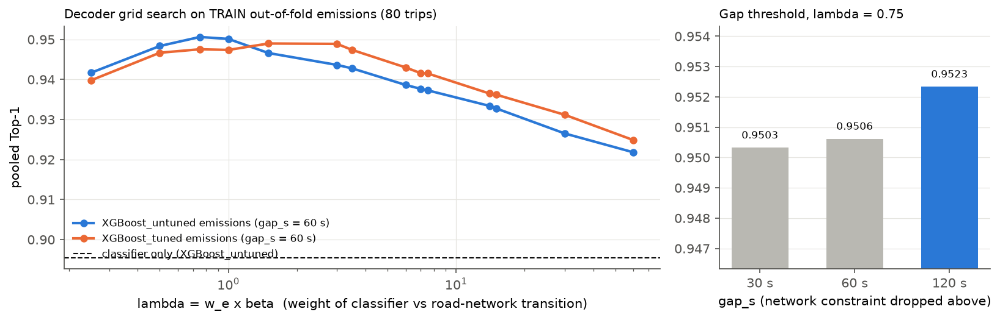
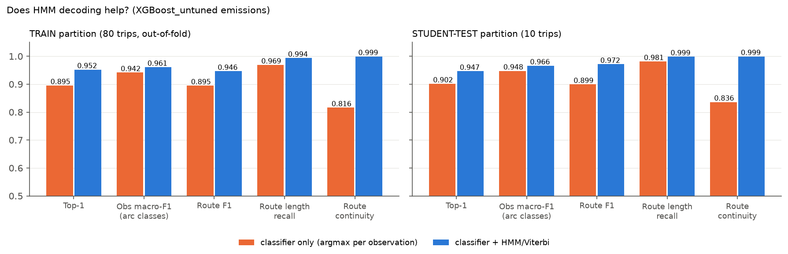
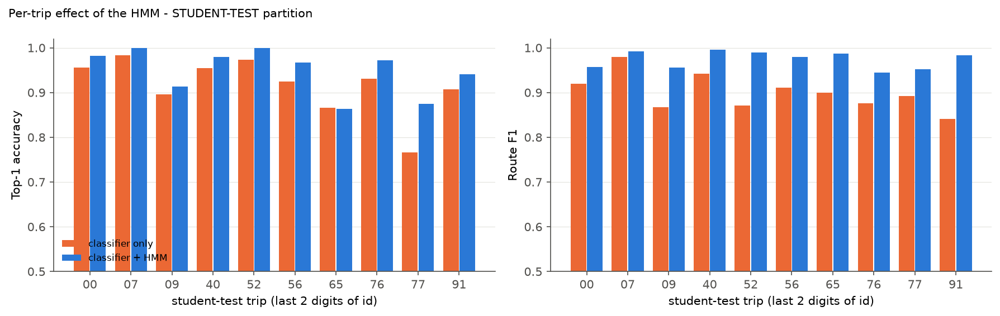

<!-- Account A → Aditya: paste everything below the line at the `<!-- A: results table + Q6 -->` marker in report §5,
     then delete this file. Figure/Table numbers continue after §4 (Figures 24–26, Table 2) – renumber if §4 differs.
     Every number comes from results/hmm/*.csv, artifacts/final/*.json and results/hmm/pipeline_smoke_student_test.csv
     (scripts/07_hmm_experiments.py, 08_export_final.py, 09_plot_hmm.py). -->

---

#### 5.x Decoder parameter selection (train partition only)

The emission and transition terms enter Viterbi as `w_e·Σ log p − Σ|d_route − d_gps|/β`. Multiplying everything
by β does not change the arg-max, so **only the product λ = w_e·β changes the decoded path**. For example,
(β = 15, w_e = 2) and (β = 30, w_e = 1) gave identical results. The gap threshold `gap_s` is the second free
parameter. We tuned both on **out-of-fold** emissions for the 80 train trips: each trip was scored by an XGBoost
model fitted on the other four GroupKFold folds (the same folds as §3/§4), so the decoder never sees optimistic
probabilities. Neither the student-test nor the evaluator partition was used.

* Grid: β ∈ {3, 7, 15, 30} × w_e ∈ {0.5, 1, 2}, plus w_e ∈ {0.083, 0.167, 0.25, 0.333} at β = 3, giving
  λ from 0.25 to 60. We ran it for both emission models (untuned and Optuna-tuned XGBoost).
* We then compared gap_s ∈ {30, 60, 120} s at the best λ.
* The objective was pooled observation Top-1 over the 182,415 labelled train observations, with route F1 as the
  tie-break. The whole grid ran in about 90 s on 8 cores.

*Figure 27 – Decoder grid search on train out-of-fold emissions [train]. Top-1 peaks at λ ≈ 0.75 and drops when
the classifier is trusted too much (λ → 60, the decode moves back towards the classifier-only result) or too
little (λ = 0.25, the decode follows network geometry even where the classifier is confident).*

**Selected configuration** (`artifacts/final/hmm_config.json`): β = 3 m, w_e = 0.25 (λ = 0.75), gap_s = 120 s,
v_max = 50 m/s, emission model **untuned XGBoost**. At their own best λ the untuned emissions reach 0.9523
train-OOF Top-1, against 0.9490 for the tuned emissions. So the final emission model is the §3 XGBoost. The §4
tuned model is kept as an artifact, but it did not win inside the HMM.

#### 5.x Classifier-only vs classifier + HMM

| Partition | Decoder | Top-1 | Obs macro-F1 (arcs) | Route precision | Route recall | Route F1 | Route length recall | Route continuity |
|---|---|---|---|---|---|---|---|---|
| Train (80 trips, OOF) | classifier only | 0.8954 | 0.9416 | 0.9031 | 0.8868 | 0.8949 | 0.9691 | 0.8160 |
| Train (80 trips, OOF) | **classifier + HMM** | **0.9523** | **0.9610** | **0.9050** | **0.9920** | **0.9465** | **0.9936** | **0.9994** |
| Student-test (10 trips) | classifier only | 0.9015 | 0.9476 | 0.9141 | 0.8852 | 0.8994 | 0.9814 | 0.8362 |
| Student-test (10 trips) | **classifier + HMM** | **0.9466** | **0.9662** | **0.9488** | **0.9953** | **0.9715** | **0.9986** | **0.9995** |

*Table 3 – Untuned-XGBoost emissions; HMM with β = 3, w_e = 0.25, gap_s = 120 s. Top-1 and macro-F1 are over
labelled observations. Route metrics compare the set of predicted route arcs (after shortest-path gap filling)
with the reference `.route` arcs. Length recall is the share of reference route length covered. Continuity is the
share of consecutive route arcs that are joined head-to-tail. Source: `results/hmm/train_oof_summary.csv`,
`student_test_summary.csv`.*

*Figure 28 – Classifier-only vs classifier + HMM [train out-of-fold, student_test].*

*Figure 29 – Per-trip Top-1 and route F1, classifier-only vs HMM [student_test].*

**Q6 – Did HMM decoding improve the final route? Yes, on every route-level measure and on almost every trip.**

* **Observation level.** Top-1 rises from 0.9015 to **0.9466** on student-test (+4.5 points, about 46 % of the
  remaining errors removed) and from 0.8954 to 0.9523 on train out-of-fold (+5.7 points). The gain comes mainly
  from the error type found in §3.4: short **reverse-direction flips** on two-way roads. A flip to the opposite
  arc for one or two observations needs a U-turn at a node. Its along-network distance is much longer than the
  1-s GPS displacement, so the transition term rejects it. Trip 00000077, which had 49 % of the classifier's
  errors, improves the most: from 0.7665 to **0.8743**.
* **Route level.** Route F1 rises from 0.8994 to **0.9715** and continuity from 0.836 to **0.9995**. Classifier-only
  routes break at about one in six arc changes, while the HMM route is connected except where we deliberately
  restart the chain. Route recall reaches 0.995 because the shortest-path expansion recovers arcs driven between
  two GPS fixes, which the classifier can never predict when no observation falls on a short arc.
* **Cost.** On the deployed pipeline (`results/hmm/pipeline_smoke_student_test.csv`), a full trip takes 50–974 ms
  end to end, including feature building and HMM decoding.

**Cases where the HMM did not help**

* **Student-test trip 00000065** (Top-1 0.8659 → 0.8633, −0.3 points). It is the only student-test trip with a
  gap above gap_s (one 210 s gap, one gap break), so the network constraint is dropped once. Its remaining errors
  are not removed by the transition model. The route F1 still rises from 0.900 to 0.986, because the
  reconstructed route is connected.
* **Train trips:** the HMM improved Top-1 on 70 trips, tied on 3 and was worse on 7. The worst drops are trip 22
  and trip 89 (−1.9 points each). Trip 22 is the most down-sampled trip (only 53 % of steps are 1 s apart).
  A likely cause: with multi-second steps the "network distance ≈ GPS distance" assumption is weaker, and
  β = 3 m then penalises legitimate turns between fixes.
* **Disconnected candidates.** 1,671 of the 1,798 chain restarts on train come from trip 54. Its reference route
  is truncated, and its GPS is far from the supplied network (median 84 m to the nearest node, Stage 1), so
  consecutive candidate sets are often unreachable from each other. Without the restart rule the decode would be forced through impossible
  transitions.
* **Route precision** increases only slightly on train (0.9031 → 0.9050), because shortest-path gap filling can
  insert a wrong detour when two consecutive decoded arcs are far apart.
