

# PathSnap: Distributed Map-Matching & Route Reconstruction

## Technical Report – UE24CS352A Machine Learning Hackathon

PES University, RR Campus · Department of Computer Science and Engineering · **Section H**

| Name | SRN |
|---|---|
| Samvith Vaddiparthi | PES1UG24AM468 |
| Vikas MS | PES1UG24AM469 |
| Aditya A Kirankumar | PES1UG24AM470 |
| Haneesh E | PES1UG24AM471 |

Repository: <https://github.com/samvithvaddiparthi-ship-it/ML_hackathon->

*AI-use disclosure: see Section 8.*

<!-- Writing rule for every section: only numbers produced by scripts in this repo; say which partition
     (train / student_test) each result uses. TODO(A) = filled by the ML-core stream after Stages A3–A5.
     TODO(team) = every member reviews and rewrites in their own words before submission. -->

## 1. Problem overview

A GPS receiver reports one noisy position per second, while the vehicle is always on a road. PathSnap
assigns every GPS observation to the directed road arc the vehicle was actually on, and joins those arcs into
a connected route. We frame this as candidate classification: for each observation, the arcs within 50 m are
candidates, and a classifier estimates the probability that each candidate is the true arc. The best candidate
gives the observation-level prediction, and HMM/Viterbi decoding uses the probabilities to produce a
consistent route. The trained system runs behind a FastAPI server on Laptop 1, and the evaluator uses a
browser UI on Laptop 2.

## 2.2 Dataset understanding and exploratory data analysis

*Partitions: train (80 trips) and student_test (10 trips). The evaluator-test partition was never used for
development. Produced by `scripts/01_inventory.py`, `eda/02_eda.py` and `scripts/02_build_dataset.py`; numbers in
`results/stage1/`, `results/eda/eda_summary.md` and `results/dataset/`.*

### 2.2.1 Data structure and inventory

Each trip folder `<id>/` contains four headerless, whitespace-separated files: `.track` (lon, lat, t),
`.nodes` (lon, lat; row = node id), `.arcs` (from-node, to-node; row = arc id) and `.route` (reference arc ids
in driving order). Every trip has its own road network, so node and arc ids are local to a trip.

| Partition | Trips | GPS observations | Obs / trip (min – median – max) | Arcs / trip (median) |
|---|---|---|---|---|
| train | 80 | 208,417 | 361 – 1,529 – 19,313 | 19,527 |
| student_test | 10 | 19,160 | 262 – 1,420 – 3,958 | 13,145 |

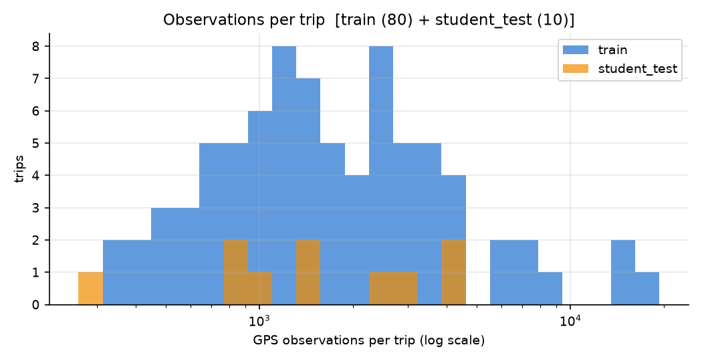
*Figure 1 – GPS observations per trip [train + student_test].*

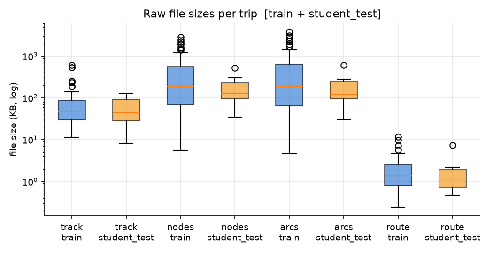
*Figure 2 – Raw file sizes per trip [train + student_test].*

### 2.2.2 Missing-value analysis

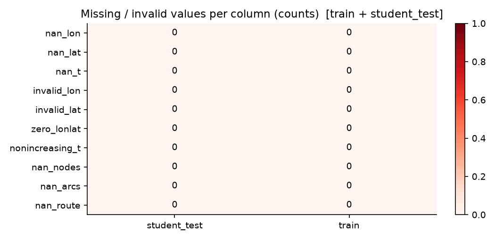
*Figure 3 – NaN and invalid-value counts per column [train + student_test].*

No column of any file contains NaN values, out-of-range or (0, 0) coordinates, and timestamps are strictly
increasing in every trip. No imputation is therefore needed. The data-quality problems are instead irregular
sampling, GPS jumps and imperfect reference routes (below).

### 2.2.3 Sampling and time gaps

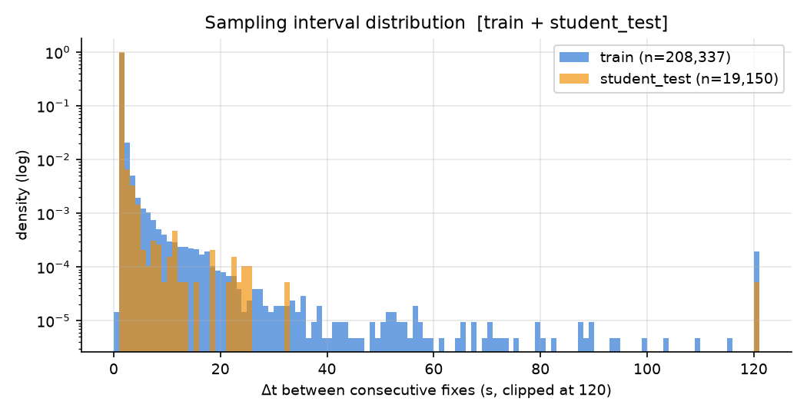
*Figure 4 – Distribution of the sampling interval Δt (log density) [train + student_test].*

*Figure 5 – Gaps per trip and share of 1 Hz steps [train + student_test].*

The median Δt is 1 s, but the train partition has 1,216 gaps above 5 s and 133 above 30 s (student_test: 44 and 2).
Some trips are strongly down-sampled (lowest share of 1 s steps: 53 % in train, 86 % in student_test), and a
few contain gaps of hours. Three trips have non-integer timestamps.

### 2.2.4 Speed, jumps and GPS noise

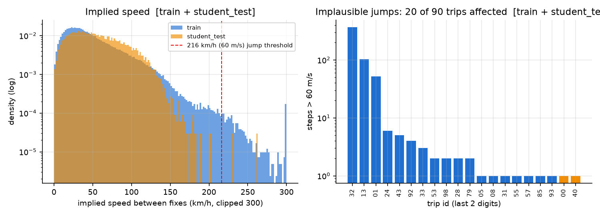
*Figure 6 – Implied speed between fixes and number of implausible (> 60 m/s) jumps per trip [train + student_test].*

*Figure 7 – Distance from each GPS fix to the reference route [train without trips 02/33/54 + student_test].*

555 steps in 20 trips imply more than 216 km/h (trip 32 alone: 365), i.e. GPS outliers. Excluding three trips
whose reference route ends before the GPS track does (02, 33, 54), the median GPS-to-route distance is 4.9 m with
a 95th percentile of 17.6 m (train) and 5.2 m / 16.8 m (student_test). The reference routes also contain 14
non-contiguous steps, so they are treated as imperfect labels.

### 2.2.5 Geography, trajectories and road networks

*Figure 8 – Trip centres [train + student_test].*

*Figure 9 – GPS trajectories in per-trip metric coordinates [trips as labelled].*

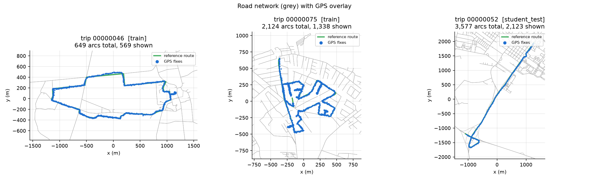
*Figure 10 – Road network (grey), reference route (green) and GPS (blue) [trips as labelled].*

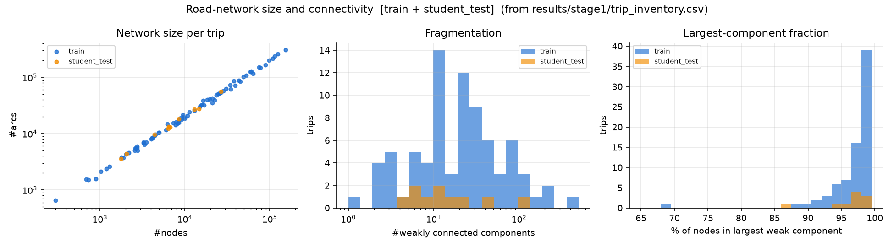
*Figure 11 – Network size and connectivity [train + student_test].*

Trips are spread over several continents. Networks range from 649 to 307,392 arcs, about 95 % of arcs have a
reverse arc (two-way roads are stored as two directed arcs), and networks are fragmented into 1 – 421 weakly
connected components.

### 2.2.6 Folium map

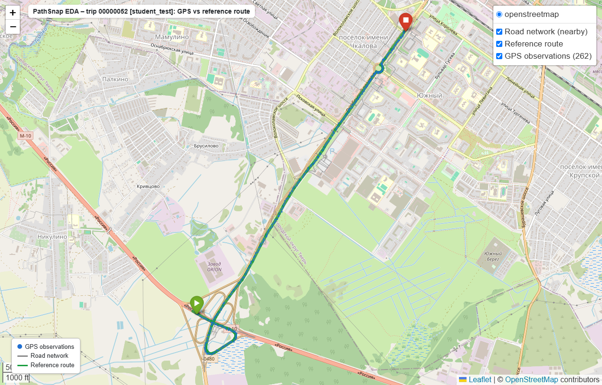
*Figure 12 – Folium map of trip 00000052 [student_test]: GPS observations, road network within 150 m, reference
route, layer control and legend. Interactive version: `results/maps/eda_student_test_00000052.html`
(train example: `eda_train_00000075.html`).*

### 2.2.7 Preprocessing and feature engineering

**Q1 – How did we preprocess the data?**

1. **Projection.** All coordinates of a trip are projected with an azimuthal-equidistant projection centred on
   the trip (`pathsnap.geo.make_projector`). Trips are spread across many countries, so no single UTM zone fits,
   while a per-trip projection keeps distance errors far below the 5 m GPS noise. All distances and headings
   are then computed in metres.
2. **No cleaning by deletion.** There are no missing values (§2.2.2). Jumps and gaps are kept, because the API
   must return an arc for every observation; they are encoded as features instead (`jump`, `dt_prev`, `dt_next`).
3. **Per-observation labels** (`pathsnap.labels`). The `.route` file lists arcs, not one arc per GPS point. Each
   observation is therefore aligned to the route by a monotone dynamic-programming alignment: the route index
   may only stay or advance, which resolves loops and parallel roads. Points more than 30 m from their aligned
   arc get no label and are excluded from training and scoring. This removes the truncated-route tails found in
   §2.2.4. 87.5 % of train and 99.2 % of student_test observations are labelled.
4. **Candidate generation** (`RoadNet.candidates`). For each observation we keep the arcs within 50 m, at most 12.
   The radius follows from §2.2.4: on train, 30 m already covers 100 % of labelled points
   (`results/dataset/radius_study.csv`), and 50 m adds a safety margin. This gives 6.6 (train) and 7.7
   (student_test) candidates per observation. The true arc is missing from the candidate set for only 0.19 %
   (train) and 0.04 % (student_test) of labelled observations.

**Q2 – Patterns observed and features extracted.** Each EDA finding motivated a group of the 25 features in
`pathsnap/features.py`. All of them are independent of the trip, using no absolute coordinates or ids, so a
model trained on 80 cities transfers to unseen ones.

| EDA observation | Feature group (features) | Why |
|---|---|---|
| GPS noise ≈ 5 m median, 17 m p95 (§2.2.4) | geometric: `dist`, `dist_rank`, `dist_minus_min`, `dist_ratio_min`, `gauss_norm` (σ = 5 m), `t_along`, `arc_len` | how plausible the candidate is given the noise level, relative to the other candidates |
| ≈ 95 % of arcs have a reverse arc (§2.2.5) | direction: `cos_head`, `abs_cos_head`, `head_reliab`, `has_reverse_cand` | both directions of a two-way road are equally close, and only the travel heading separates them |
| 1 Hz trajectories follow a road for many seconds (§2.2.3) | temporal: `win2_mean/max`, `win5_mean/max`, `win5_rank` (distance of neighbouring points i ± 2 / ± 5 to the same arc) | one noisy point can look closer to a side road, but its neighbours show which road the track follows |
| gaps, down-sampling, jumps (§2.2.3–4) | kinematics: `speed`, `dt_prev`, `dt_next`, `jump` | tell the model when heading and neighbours are unreliable |
| fragmented networks, junctions (§2.2.5) | topology / context: `out_deg_v`, `in_deg_u`, `cont_prev`, `cont_next`, `n_cand` | connectivity with the neighbours' nearest arcs; density of the local network |

A nearest-arc rule reaches only 56.2 % (train) and 54.0 % (student_test) Top-1. This is mainly because both
directions of a two-way road are equally near, which is why the direction and temporal features matter.

## 3. Model experimentation and comparison

**Protocol** (`scripts/03_train_models.py`, identical for every model). Cross-validation is GroupKFold(5) over the
80 **train** trips, so a trip is never in both the training and validation folds. Models are fitted on the
labelled candidate rows of 4 folds and evaluated on the held-out trips. For student-test evaluation, each model
is refitted on all 80 train trips and evaluated once on the 10 **student_test** trips. Student-test results
were not used to choose or tune any model.

**Metrics.** **Top-1 accuracy** is measured per observation: the share of labelled observations whose
highest-scoring candidate is the true arc. **Macro-F1** in the model tables is the candidate-level binary
macro-F1, at threshold 0.5, of the "is this the true arc" classifier. We also report the observation-level
macro-F1 over arc ids, which is what the API's `score_trip` returns. **Log loss** is the binary cross-entropy of
the candidate probabilities. **Route continuity** is the share of consecutive predicted route arcs that are
connected head-to-tail. **Inference time** is ms per 1,000 GPS observations on student_test, for scoring only,
measured on the training machine (`st_infer_ms_per_1k_obs`).

**Primary metric.** CV Top-1 is the selection metric, because the route is built from per-observation Top-1
choices. CV log loss is the tie-breaker, because the probabilities become HMM emission probabilities, so
calibration matters.

### 3.1 Overall model comparison

| Model | Family | Key configuration | CV macro-F1 (± std) | CV Top-1 (± std) | ST Top-1 | ST route continuity | ST macro-F1 (candidate / obs-arc) | ST log loss (CV) | Inference ms / 1k obs |
|---|---|---|---|---|---|---|---|---|---|
| **XGBoost** | Boosting | hist, 400 rounds, lr 0.05, depth 8, subsample/colsample 0.8 | 0.9366 ± 0.0094 | **0.8958 ± 0.0177** | 0.9015 | **0.836** | 0.9408 / 0.9476 | 0.0642 (**0.0759**) | 12.2 |
| LightGBM | Boosting | 400 rounds, lr 0.05, 63 leaves, min_child 50, subsample/colsample 0.8 | 0.9366 ± 0.0095 | 0.8953 ± 0.0183 | **0.9034** | 0.832 | 0.9407 / 0.9473 | 0.0640 (0.0762) | 46.3 |
| RandomForest | Bagging | 150 trees, min_leaf 5, max_features √, max_samples 0.25 | 0.9340 ± 0.0095 | 0.8945 ± 0.0162 | 0.8946 | 0.826 | 0.9354 / 0.9435 | 0.0687 (0.0798) | 18.5 |
| DecisionTree | Tree | CART gini, max_depth 12, min_leaf 50 | 0.9312 ± 0.0089 | 0.8891 ± 0.0180 | 0.8941 | 0.818 | 0.9329 / 0.9442 | 0.0768 (0.0931) | 0.30 |
| MLP | Neural net | 25-64-32-1 ReLU, Adam lr 1e-3, α 1e-4, batch 2048, 20 epochs | 0.9295 ± 0.0091 | 0.8889 ± 0.0169 | 0.8941 | 0.816 | 0.9328 / 0.9339 | 0.0723 (0.0849) | 1.36 |
| LogisticRegression | Linear | scaled, L2, C 1.0, lbfgs | 0.9128 ± 0.0075 | 0.8749 ± 0.0167 | 0.8631 | 0.782 | 0.9111 / 0.8906 | 0.1004 (0.1114) | 0.36 |
| KNN | Instance-based | scaled, k 25, distance-weighted; fit on 150k-row subsample | 0.9161 ± 0.0100 | 0.8734 ± 0.0177 | 0.8664 | 0.807 | 0.9152 / 0.9077 | 0.1194 (0.1317) | 798 |
| GaussianNB | Probabilistic | var_smoothing 1e-9 | 0.7803 ± 0.0135 | 0.7770 ± 0.0682 | 0.7537 | 0.800 | 0.7827 / 0.8338 | 1.2477 (1.3767) | 0.79 |

*Table 1 – Source: `results/models/comparison.csv`, `cv_folds.csv`, `model_configs.json`. CV = mean of 5 GroupKFold
folds on train; ST = student_test. For reference, the nearest-arc baseline reaches 54.0 % ST Top-1. Every
metric applies to every model, so there are no N/A cells. KNN is the only model fitted on a 150,000-row
subsample, because its prediction cost grows with the size of the training set.*

**Selection.** XGBoost has the best CV Top-1 (the primary metric) and the best CV log loss, and it scores 4×
faster than LightGBM. LightGBM is 0.2 points higher on student_test Top-1, but that gap is smaller than one
fold standard deviation (≈ 1.8 points), and we deliberately did not select on the test partition. XGBoost
therefore goes to Bayesian optimisation (§4).

### 3.2 Per-model analysis

Train-vs-CV numbers are the mean over the 5 folds of Top-1 on the fold's own training trips and on its held-out
trips (Figure 17).

#### 3.2.1 Logistic regression

* **A1 – Why suitable.** A linear model of the 25 standardised features is the simplest probabilistic baseline,
  and it shows how much of the problem is linearly separable.

* **A2 – Strengths / limits.** It is fast (0.36 ms / 1k obs), its probabilities are well behaved, and there is
  essentially no overfitting. It cannot model interactions, though: a small `dist` should count for more when
  `head_reliab` is high. It ends 2.1 points below XGBoost in CV Top-1.

* **B5 – Hyper-parameters.** StandardScaler, L2 penalty, C = 1.0, lbfgs, max_iter = 500 (initial and final values).
* **B6 – Objective.** Binary cross-entropy plus an L2 penalty.
* **C7/C8 – Student-test.** Top-1 0.8631, candidate macro-F1 0.9111, observation-level macro-F1 0.8906, log loss 0.1004, continuity 0.782.
* **C9 – Fit.** Train 0.8759 vs CV 0.8749: a gap of 0.001, which means **mild underfitting**. The model has too
  little capacity, not too much.

#### 3.2.2 Gaussian Naive Bayes

* **A1 – Why suitable.** It is a fast generative baseline that models each feature as Gaussian given the class.
* **A2 – Strengths / limits.** It trains in 0.17 s, but it assumes the features are independent within each
  class. Our features are strongly correlated: on a 300k-row train sample, `dist`/`win2_mean` have |r| = 0.93 and
  `win2_max`/`win5_mean` 0.93, and 7 of the 300 feature pairs exceed 0.8. The model therefore counts the same
  evidence several times and becomes over-confident.

* **B5 – Hyper-parameters.** var_smoothing = 1e-9 (default).
* **B6 – Objective.** Maximum-likelihood estimates of the class priors and the per-class Gaussian means and
  variances. There is no iterative loss.

* **C7/C8 – Student-test.** Top-1 0.7537, candidate macro-F1 0.7827, observation-level macro-F1 0.8338, log loss
  1.2477, the worst by a factor of 10. Recall is 0.94 but precision only 0.49: 18,474 false positives against
  1,051 false negatives (Figure 19).

* **C9 – Fit.** Train 0.7753 vs CV 0.7770, so there is no overfitting, but the model is **unstable across trips**.
  Its fold standard deviation is 0.068, about 3.7× that of the next-worst model (0.018), and fold 4 falls to 0.6617 while
  the other folds reach 0.77–0.83 (Figure 16). This is model misspecification (underfitting), not variance from
  too little data.

#### 3.2.3 K-nearest neighbours

* **A1 – Why suitable.** Similar candidate situations (distance, heading, neighbours' support) should get similar
  labels, and KNN uses that directly, with no parametric form.

* **A2 – Strengths / limits.** It needs no training and makes no distributional assumptions. Prediction is
  slow, though: 798 ms per 1k observations, about 65× slower than XGBoost (Figure 18). Memory and time limits
  forced a 150k-row training subsample, and its probabilities are poorly calibrated (log loss 0.1194).

* **B5 – Hyper-parameters.** StandardScaler, k = 25, distance weighting, Euclidean metric, 150k-row random subsample.
* **B6 – Objective.** None: a lazy learner predicts by a distance-weighted vote of the 25 nearest training rows.
* **C7/C8 – Student-test.** Top-1 0.8664, candidate macro-F1 0.9152, observation-level macro-F1 0.9077, log loss 0.1194, continuity 0.807.
* **C9 – Fit.** Train 0.9168 vs CV 0.8734, a gap of 0.043: **overfitting**. Distance weighting gives nearby
  training rows a very high weight, and the subsample limits how well the model generalises.

#### 3.2.4 Decision tree

* **A1 – Why suitable.** Axis-aligned thresholds ("dist < x and cos_head > y") match how a human would rank
  candidates, and they capture interactions that logistic regression cannot.

* **A2 – Strengths / limits.** It is the fastest model at inference (0.30 ms / 1k obs) and it is interpretable.
  A single tree has high variance and coarse, step-like probabilities (CV log loss 0.0931 vs 0.0759 for XGBoost).

* **B5 – Hyper-parameters.** CART, gini, max_depth = 12, min_samples_leaf = 50 (initial = final).
* **B6 – Objective.** Greedy minimisation of Gini impurity at each split.
* **C7/C8 – Student-test.** Top-1 0.8941, candidate macro-F1 0.9329, observation-level macro-F1 0.9442, log loss 0.0768, continuity 0.818.
* **C9 – Fit.** Train 0.9128 vs CV 0.8891, a gap of 0.024: **mild overfitting**, limited by the depth and leaf-size caps.

#### 3.2.5 Random forest

* **A1 – Why suitable.** Bagging many decorrelated trees reduces a single tree's variance while keeping its
  ability to model interactions.

* **A2 – Strengths / limits.** It is the most stable model across folds (CV Top-1 standard deviation 0.0162, the
  lowest) and it is robust to feature scale. It is the slowest model to train (54 s on all train trips) and
  needs 18.5 ms / 1k obs at inference.

* **B5 – Hyper-parameters.** 150 trees, max_depth = None, min_samples_leaf = 5, max_features = √25, max_samples = 0.25.
* **B6 – Objective.** Gini impurity per tree; probabilities are averaged over the trees.
* **C7/C8 – Student-test.** Top-1 0.8946, candidate macro-F1 0.9354, observation-level macro-F1 0.9435, log loss 0.0687, continuity 0.826.
* **C9 – Fit.** Train 0.9303 vs CV 0.8945, a gap of 0.036: **moderate overfitting** from the fully grown trees.

#### 3.2.6 LightGBM

* **A1 – Why suitable.** Gradient-boosted trees are the standard strong learner for tabular features with
  interactions, and they directly optimise log loss, which the HMM needs.

* **A2 – Strengths / limits.** It has the best student_test Top-1 (0.9034) and log loss (0.0640), and it trains
  fast (15.9 s). Its leaf-wise trees overfit without early stopping, and inference costs 46.3 ms / 1k obs, the
  second slowest.

* **B5 – Hyper-parameters.** 400 rounds, learning rate 0.05, num_leaves 63, min_child_samples 50, subsample 0.8 (every round), colsample_bytree 0.8.
* **B6 – Objective.** Binary log loss, optimised by gradient boosting.
* **C7/C8 – Student-test.** Top-1 0.9034, candidate macro-F1 0.9407, observation-level macro-F1 0.9473, log loss 0.0640, continuity 0.832.
* **C9 – Fit.** Train 0.9434 vs CV 0.8953, a gap of 0.048: **overfitting**. In the fold-0 loss curve (Figure 20),
  validation log loss reaches its minimum of 0.0828 at round 128 and rises to 0.0855 by round 400, while training
  loss keeps falling (0.0606 at round 120, 0.0449 at round 400). Beyond about 130 rounds the model fits noise.

#### 3.2.7 XGBoost (selected)

* **A1 – Why suitable.** It is the same family as LightGBM, with depth-wise trees and second-order optimisation
  of log loss. Its calibrated probabilities feed straight into the HMM emissions.

* **A2 – Strengths / limits.** It has the best CV Top-1 (0.8958) and CV log loss (0.0759), and the best student_test
  continuity (0.836), at 12.2 ms / 1k obs, 4× faster than LightGBM. Like LightGBM, it overfits at 400 rounds
  without tuning.

* **B5 – Hyper-parameters (initial, before §4).** tree_method hist, n_estimators 400, learning_rate 0.05,
  max_depth 8, subsample 0.8, colsample_bytree 0.8, and defaults min_child_weight 1, reg_lambda 1, gamma 0.

* **B6 – Objective.** Binary log loss (`eval_metric = logloss`), plus an L2 penalty on the leaf weights, optimised
  with gradient and Hessian information.

* **C7/C8 – Student-test.** Top-1 0.9015, candidate macro-F1 0.9408, observation-level macro-F1 0.9476, log loss
  0.0642, continuity 0.836. Confusion matrix (candidate level, threshold 0.5): TN 125,528, FP 1,726, FN 2,153,
  TP 16,851.

* **C9 – Fit.** Train 0.9480 vs CV 0.8958, a gap of 0.052, the largest: **overfitting**. Validation log loss
  bottoms at 0.0815 at round 120 and rises to 0.0855 at round 400, while training loss falls to 0.0429
  (Figure 20). This is the main target for Bayesian optimisation: the number of rounds, depth and regularisation.

#### 3.2.8 Multi-layer perceptron

* **A1 – Why suitable.** A small neural network learns smooth non-linear interactions between the standardised
  features, and it produces genuine epoch-by-epoch training histories.

* **A2 – Strengths / limits.** It is fast at inference (1.36 ms / 1k obs) and its probabilities are smooth. It is
  sensitive to scaling and the learning rate, and with 20 epochs it stays 0.7 points below XGBoost in CV Top-1.

* **B5 – Hyper-parameters.** StandardScaler, layers 25-64-32-1, ReLU, Adam, lr 1e-3, L2 α = 1e-4, batch 2048,
  20 epochs (trained with `partial_fit` so that the losses are recorded every epoch).

* **B6 – Objective.** Binary cross-entropy plus an L2 penalty, minimised with Adam.
* **C7/C8 – Student-test.** Top-1 0.8941, candidate macro-F1 0.9328, observation-level macro-F1 0.9339, log loss 0.0723, continuity 0.816.
* **C9 – Fit.** Train 0.9060 vs CV 0.8889, a gap of 0.017: **slight overfitting**. In Figure 20, validation log
  loss drops from 0.1016 (epoch 1) to 0.0913 (epoch 6), then stays flat at about 0.090–0.093 (best 0.0898 at
  epoch 16), while training loss keeps falling to 0.070. After about 6 epochs there is no further gain.

### 3.3 Model visualisations

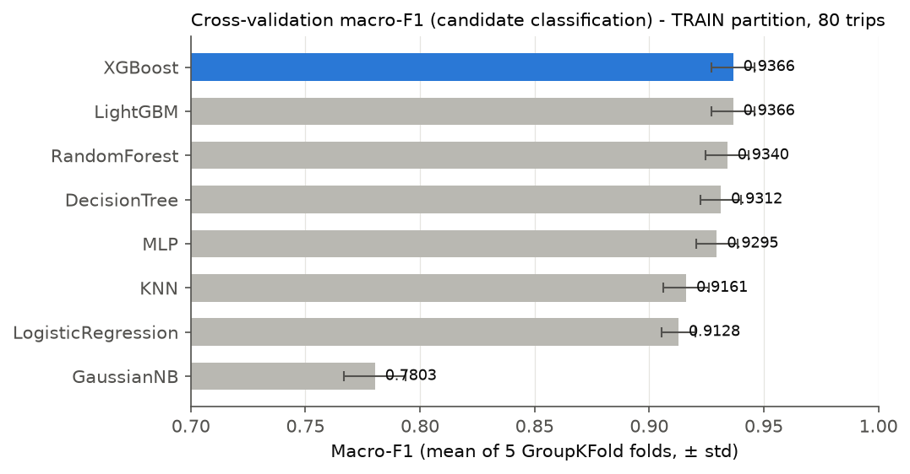
*Figure 13 – CV macro-F1 (candidate level), mean ± std of 5 GroupKFold folds [train].*

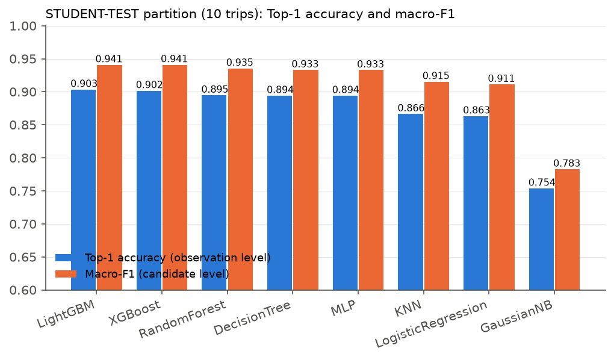
*Figure 14 – Top-1 accuracy and macro-F1 [student_test].*

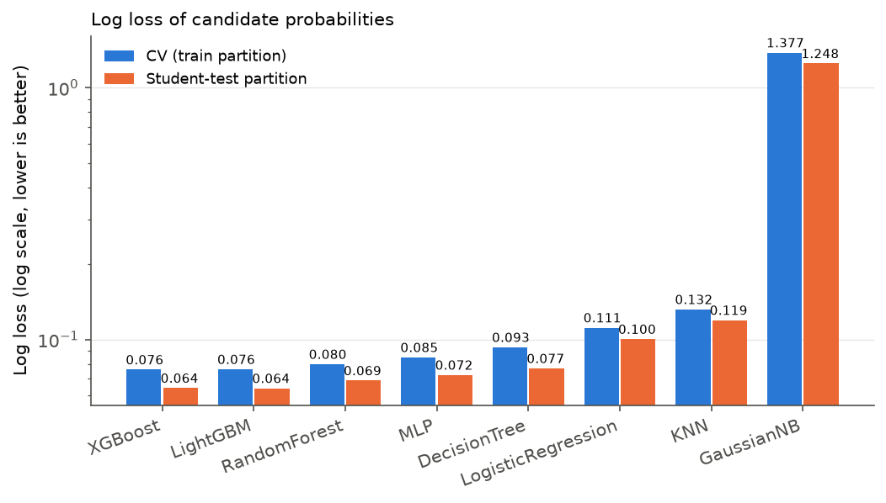
*Figure 15 – Log loss, CV [train] and student-test [student_test], log scale.*

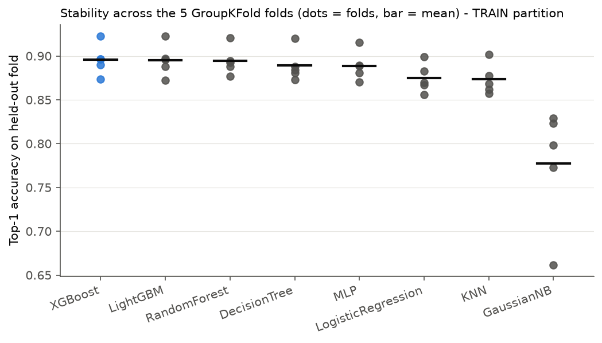
*Figure 16 – Top-1 on each held-out fold [train]: GaussianNB's fold 4 outlier.*

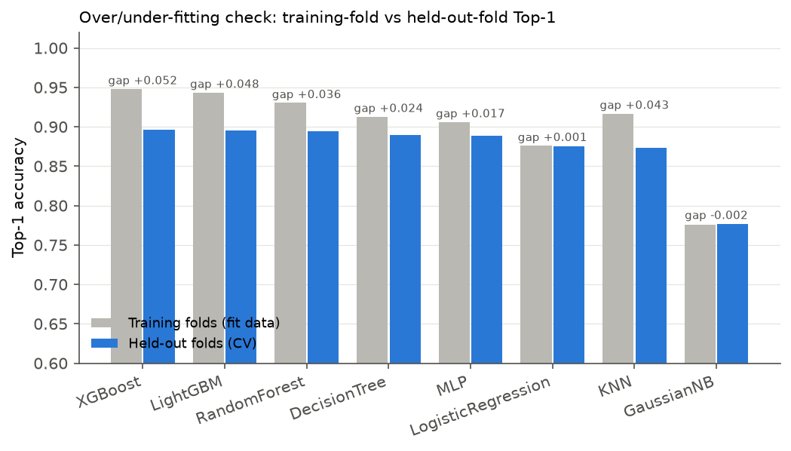
*Figure 17 – Training-fold vs held-out-fold Top-1, an over/underfitting check [train].*

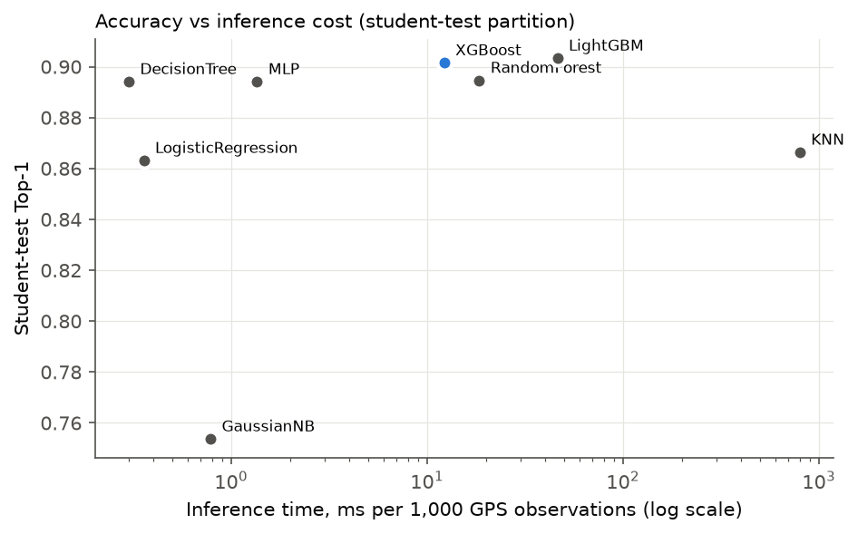
*Figure 18 – Student-test Top-1 vs inference time per 1,000 observations [student_test].*

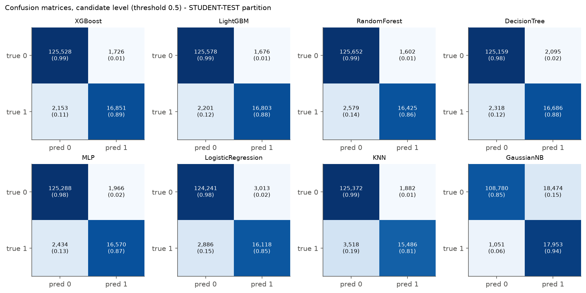
*Figure 19 – Candidate-level confusion matrices at threshold 0.5 [student_test].*

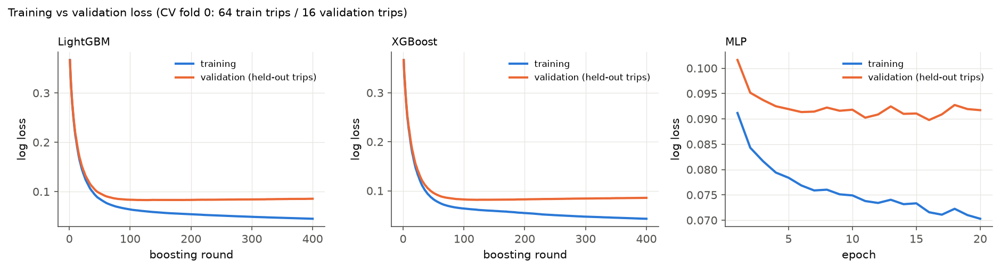
*Figure 20 – Real training vs validation log loss, CV fold 0 (64 train / 16 validation trips) [train]. Only the
models with an iterative training history are shown (LightGBM and XGBoost by round, MLP by epoch).*

### 3.4 Error analysis of the selected model

*Partition: student_test (19,012 labelled observations). Script `analysis/error_analysis.py`, outputs in
`results/analysis/`. The scores come from the saved `artifacts/models/XGBoost.joblib`, applied to regenerated
candidate tables, which gives Top-1 0.9003 (Table 1: 0.9015; the 0.1-point difference comes from regenerating
the candidates on a different machine).*

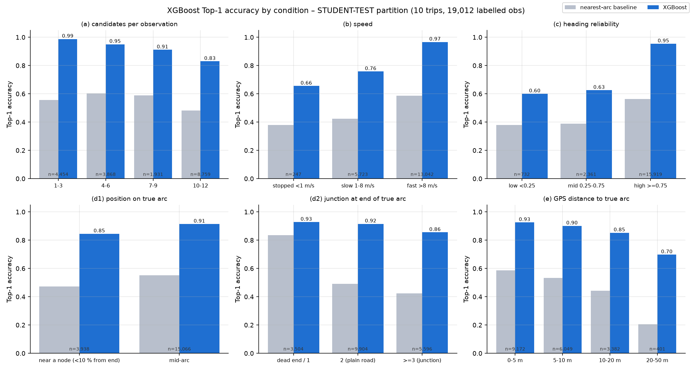
*Figure 21 – XGBoost vs nearest-arc Top-1 by condition [student_test].*

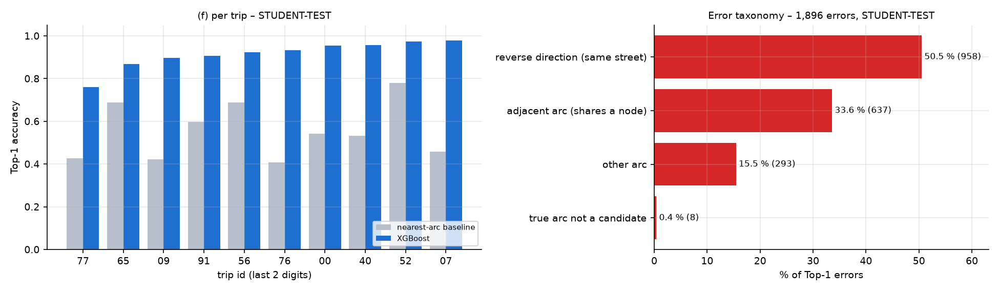
*Figure 22 – Top-1 per trip and taxonomy of the 1,896 errors [student_test].*

* **Speed and heading drive the errors.** Top-1 is 96.7 % above 8 m/s, but 75.9 % at 1–8 m/s. These slow
  observations are 30.1 % of the data and hold 72.8 % of all errors. When heading reliability is low, Top-1 falls
  to 60.1 %.

* **50.5 % of errors are "right street, wrong direction"**: the predicted arc is the reverse of the true one. These
  are short flips (465 runs, median length 1 observation, longest 23), not long wrong stretches. A further 33.6 %
  pick an arc that shares a node with the true arc: Top-1 is 84.6 % near arc ends vs 91.5 % mid-arc, and 85.6 %
  at junctions. Only 8 errors are candidate-generation misses.

* **One trip dominates.** Trip 00000077 holds 49.4 % of all errors (Top-1 76.0 %, 739 reverse-direction errors).
  It is a slow trip, with a median speed of 5.5 m/s. The other nine trips range from 86.7 % to 98.0 %.

* Dense networks are harder: Top-1 is 98.8 % with 1–3 candidates and 83.0 % with 10–12.
* Most of these errors are isolated flips while the street itself is right. They are exactly what a transition
  model over connected, consistently directed arcs should correct (§5).

## 4. Bayesian hyperparameter optimisation

*Model: XGBoost, the model selected in §3. Code: `scripts/05_bayes_opt.py`, `scripts/06_plot_bayes.py`. Outputs:
`results/bayes_opt/` (`study.db` is the full Optuna search record). Partition: **train** only for the search; student_test
is evaluated once, after the search.*

**Q1 – Method.** We used Optuna's TPE (Tree-structured Parzen Estimator) sampler. TPE is a Bayesian optimiser: it
splits the completed trials into a "good" and a "bad" group, models each group's hyper-parameter density, and
proposes the next trial where the ratio of good to bad density is highest. The first 10 trials are random
(seed 42) to seed the model. A MedianPruner (8 start-up trials, 1 warm-up fold) stops a trial after a CV fold when its running mean is below
the median of earlier trials at the same fold. 15 of the 40 trials (38 %) were stopped early this way.

**Q2 – Search space** (nine XGBoost hyper-parameters). We used log-uniform ranges where the plausible values span
orders of magnitude:

| Hyper-parameter | Search range / distribution | Untuned (Stage A2) | Best (trial 31) | fANOVA importance |
|---|---|---|---|---|
| `n_estimators` | int [100, 800], log-uniform | 400 | 410 | 0.02 |
| `learning_rate` | float [0.01, 0.3], log-uniform | 0.05 | 0.02384 | 0.10 |
| `max_depth` | int [3, 12] | 8 | 6 | 0.02 |
| `min_child_weight` | float [1, 200], log-uniform | 1 (default) | 9.881 | 0.04 |
| `subsample` | float [0.5, 1.0] | 0.8 | 0.7585 | 0.62 |
| `colsample_bytree` | float [0.4, 1.0] | 0.8 | 0.4094 | 0.03 |
| `gamma` | float [0, 5] | 0 (default) | 4.851 | 0.03 |
| `reg_lambda` | float [1e-3, 50], log-uniform | 1 (default) | 0.1765 | 0.05 |
| `reg_alpha` | float [1e-3, 10], log-uniform | 0 (default) | 0.003486 | 0.10 |

*Table 2 – Source: `results/bayes_opt/best_params.json`, `param_importance.csv`.*

**Q3 – Objective.** Maximise the mean observation-level Top-1 accuracy over GroupKFold(5) on the 80 train trips,
using **the same folds as §3**, so tuned and untuned results are directly comparable. CV macro-F1, log loss and the
fold standard deviation were recorded for every trial, but did not drive the search.

**Q4 – Trials.** 40 trials: 25 completed and 15 pruned. The best is **trial 31**, with CV Top-1 0.8974 (Figure 24).
The completed trials span 0.8930–0.8974. Trial 2, still in the random start-up phase, already reached 0.8967,
so most of the gain over the untuned 0.8958 came early, and TPE refined it by 0.07 points.

**Q5 – Best values and what mattered.** By fANOVA importance, `subsample` alone explains 62 % of the
objective's variance. The best region is 0.72–0.85 (Figure 26): values below 0.65 lose about 0.2–0.4 points.
`reg_alpha` and `learning_rate` follow with 0.10 each. Compared with the untuned configuration, the best trial
regularises much more strongly:

* shallower trees (depth 6 instead of 8);
* 40 % of the features per tree instead of 80 %;
* `min_child_weight` 9.9 instead of 1, and `gamma` 4.85 instead of 0;
* a smaller learning rate (0.024) with a similar number of rounds (410).

**Q6 – Tuned vs untuned.**

| Model | CV macro-F1 | CV Top-1 (± std) | Train Top-1 | CV log loss | ST Top-1 | ST macro-F1 (cand / obs-arc) | ST log loss | ST continuity | Inference ms / 1k obs: run 1 / run 2 / repeated benchmark |
|---|---|---|---|---|---|---|---|---|---|
| XGBoost (untuned) | 0.9366 | 0.8958 ± 0.0177 | 0.9480 | 0.0759 | 0.9015 | 0.9408 / 0.9476 | 0.0642 | 0.836 | 17.8 / 14.1 / **30.9** |
| XGBoost (tuned) | 0.9369 | 0.8974 ± 0.0157 | 0.9074 | 0.0759 | 0.8947 | 0.9371 / 0.9437 | 0.0672 | 0.835 | 12.1 / 14.6 / **18.9** |

*Table 3 – Source: `results/bayes_opt/tuned_vs_untuned.csv` (identical CV folds; both models refitted on all 80
train trips for student_test). Inference timing: run 1 is `results/logs/05_bayes_opt.log`, run 2 is
`results/logs/05_bayes_opt_refit.log` (the values in the CSV), each a single timing on the training machine. The
repeated benchmark is the median of 7 runs over the full student-test candidate table, from
`analysis/benchmark_inference.py` → `results/analysis/inference_benchmark.csv`, on a 2-CPU machine, so its
absolute values are higher.*

**Verdict.**

* **Cross-validation:** tuning gave a small gain (+0.16 points Top-1, macro-F1 +0.0003). That is well inside the
  fold standard deviation, and the tuned model wins on only 3 of the 5 folds (−0.09 to +0.50 points per fold).

* **Overfitting:** the clearest effect is that the overfitting identified in §3.2.7 is gone. The train-vs-CV gap
  shrinks from 5.2 to 1.0 points, and the fold standard deviation drops from 0.0177 to 0.0157.

* **Speed:** the single timings disagree (17.8 vs 12.1 and 14.1 vs 14.6 ms), so we benchmarked repeatedly. The
  tuned model is about 39 % faster (18.9 vs 30.9 ms median), as expected from its shallower trees.

* **Student-test:** the tuned model is 0.7 points *lower* in Top-1 (0.8947 vs 0.9015), and its log loss is
  slightly worse (0.0672 vs 0.0642). This is a 10-trip sample, so the difference is not conclusive either way.

* **Next step:** we did not choose between the two models on student_test. Both are carried into the HMM stage,
  and the final deployed model is chosen in §5 on CV and route-level results.

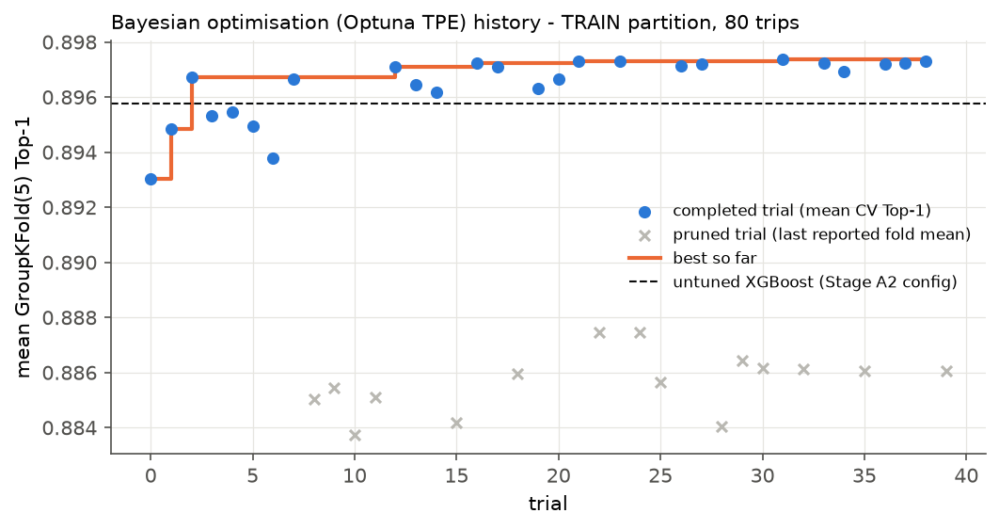
*Figure 24 – Optimisation history: completed and pruned trials, best-so-far, and the untuned reference [train, GroupKFold(5)].*

*Figure 25 – fANOVA hyper-parameter importance [train].*

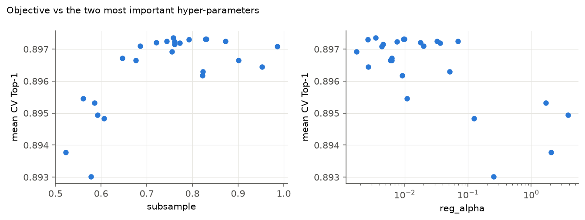
*Figure 26 – CV Top-1 vs the two most important hyper-parameters (completed trials) [train].*

*Figure 27 – Untuned vs tuned XGBoost, CV [train] and student-test [student_test].*

## 5. HMM and Viterbi route reconstruction

The classifier scores each observation independently, so §3.4 found its typical errors: one-observation flips
to the reverse arc of the same street, and jumps to an adjacent arc. A hidden Markov model adds what the
classifier cannot see, namely that consecutive observations must lie on a path the vehicle can actually drive.
Viterbi decoding then picks the single most probable arc sequence for the whole trip
(`src/pathsnap/hmm.py`, called from `pathsnap.pipeline.predict_trip(use_hmm=True)`).

**Q1 – Hidden states.** For observation *t*, the states are its candidate arcs, the same ≤ 12 candidates
the classifier scored (§2.2.7). Each state also stores the observation's projected position along the arc, so
that distances along the network can be measured between consecutive states.

**Q2 – Emission probabilities.** The emission score of candidate *k* at time *t* comes from the classifier:
log *e*t(k) = *w*e · log *p*XGBoost(k), where *p* is the calibrated probability from §3–§4.
This is why log loss was the tie-breaker in model selection: badly calibrated probabilities would distort the
balance between emission and transition. The weight *w*e sets how much the decoder trusts the
classifier relative to the network constraint. We add 10−6 inside the log so that a probability of exactly 0 never removes a state.
Deployed value: *w*e = **0.25** (§5.1).

**Q3 – Transition probabilities.** Between candidate *i* at *t−1* and candidate *j* at *t*, we compare
*d*route, the shortest driving distance over the **directed** network from the first projected
position to the second, with *d*gps, the straight-line distance between the two GPS fixes:
log *a*t(i → j) = −|*d*route − *d*gps| / β.
If the vehicle stays on the same arc, or drives on to a connected one, the two distances agree and the
transition is likely. A flip to the reverse arc of a two-way street needs a U-turn route that is much longer
than the GPS displacement, so it is heavily penalised. Because the network is directed, one-way streets are
respected automatically. A speed-based cut-off bounds the route search: transitions that would need an
implausible speed over the elapsed Δt are not allowed. The cut-off is
min(*v*max·max(Δt, 1 s) + 50 m, 3·*d*gps + 150 m), with *v*max = 50 m/s. Within one
arc, *d*route = |Δ position along the arc|. This allows small backward moves, which are GPS noise and
not real reversing. Shortest paths come from a Dijkstra search that stops at the cut-off and is cached per
source node, so the search stays local. Deployed value: β = **3 m** (§5.1).

**Q4 – Missing candidates and large time gaps.** Every observation has at least two candidates by construction
(`min_k`), so the state set is never empty. When the gap to the previous observation exceeds `gap_s`, the
network constraint is dropped for that step: the vehicle may have driven an unknown route, so the decoder
relies on the emissions alone. Each such step is counted as a gap break (`hmm.n_gap_breaks`).
Deployed value: `gap_s` = **120 s** (§5.1).

**Q5 – Disconnected candidate sets.** If no candidate at *t* is reachable from any candidate at *t−1* within
the cut-off (fragmented networks, §2.2.5, or GPS jumps, §2.2.4), the Viterbi chain is restarted at *t* from the
emissions, instead of forcing an impossible transition. Each restart is counted (`hmm.n_disconnect_breaks`).
After decoding, consecutive decoded arcs that are not directly connected are joined with their shortest-path
arcs, so `route_arcs` is a continuous, drivable route wherever the network allows it.

**Decoding.** Viterbi keeps, for every candidate at every time step, the best accumulated log score and a
back-pointer. With *T* observations and *K* ≤ 12 candidates, decoding costs O(*T*·*K*²) score updates, plus the
bounded shortest-path searches for the transitions.

### 5.1 Decoder parameter selection (train partition only)

The emission and transition terms enter Viterbi as `w_e·Σ log p − Σ|d_route − d_gps|/β`. Multiplying everything
by β does not change the arg-max, so **only the product λ = w_e·β changes the decoded path**. For example,
(β = 15, w_e = 2) and (β = 30, w_e = 1) gave identical results. The gap threshold `gap_s` is the second free
parameter. We tuned both on **out-of-fold** emissions for the 80 train trips: each trip was scored by an XGBoost
model fitted on the other four GroupKFold folds (the same folds as §3/§4), so the decoder never sees optimistic
probabilities. Neither the student-test nor the evaluator partition was used.

* Grid: β ∈ {3, 7, 15, 30} × w_e ∈ {0.5, 1, 2}, plus w_e ∈ {0.083, 0.167, 0.25, 0.333} at β = 3, giving
  λ from 0.25 to 60. We ran it for both emission models (untuned and Optuna-tuned XGBoost).
* We then compared gap_s ∈ {30, 60, 120} s at the best λ.
* The objective was pooled observation Top-1 over the 182,415 labelled train observations, with route F1 as the
  tie-break. The whole grid ran in about 90 s on 8 cores.

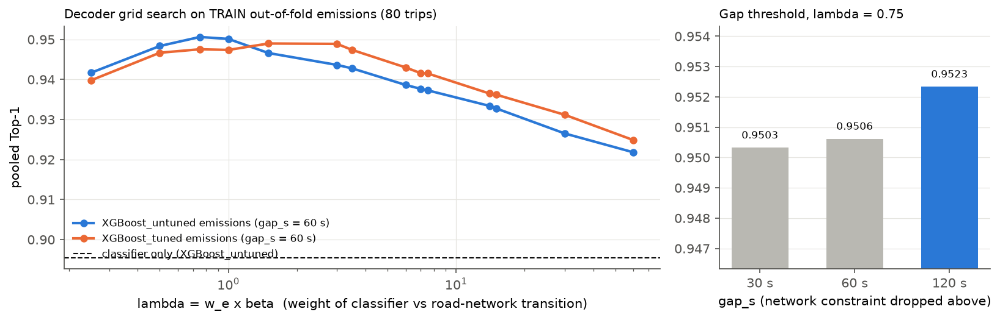
*Figure 28 – Decoder grid search on train out-of-fold emissions [train]. Top-1 peaks at λ ≈ 0.75 and drops when
the classifier is trusted too much (λ → 60, the decode moves back towards the classifier-only result) or too
little (λ = 0.25, the decode follows network geometry even where the classifier is confident).*

**Selected configuration** (`artifacts/final/hmm_config.json`): β = 3 m, w_e = 0.25 (λ = 0.75), gap_s = 120 s,
v_max = 50 m/s, emission model **untuned XGBoost**. At their own best λ the untuned emissions reach 0.9523
train-OOF Top-1, against 0.9490 for the tuned emissions. So the final emission model is the §3 XGBoost. The §4
tuned model is kept as an artifact, but it did not win inside the HMM.

### 5.2 Classifier-only vs classifier + HMM (Q6)

| Partition | Decoder | Top-1 | Obs macro-F1 (arcs) | Route precision | Route recall | Route F1 | Route length recall | Route continuity |
|---|---|---|---|---|---|---|---|---|
| Train (80 trips, OOF) | classifier only | 0.8954 | 0.9416 | 0.9031 | 0.8868 | 0.8949 | 0.9691 | 0.8160 |
| Train (80 trips, OOF) | **classifier + HMM** | **0.9523** | **0.9610** | **0.9050** | **0.9920** | **0.9465** | **0.9936** | **0.9994** |
| Student-test (10 trips) | classifier only | 0.9015 | 0.9476 | 0.9141 | 0.8852 | 0.8994 | 0.9814 | 0.8362 |
| Student-test (10 trips) | **classifier + HMM** | **0.9466** | **0.9662** | **0.9488** | **0.9953** | **0.9715** | **0.9986** | **0.9995** |

*Table 4 – Untuned-XGBoost emissions; HMM with β = 3, w_e = 0.25, gap_s = 120 s. Top-1 and macro-F1 are over
labelled observations. Route metrics compare the set of predicted route arcs (after shortest-path gap filling)
with the reference `.route` arcs. Length recall is the share of reference route length covered. Continuity is the
share of consecutive route arcs that are joined head-to-tail. Source: `results/hmm/train_oof_summary.csv`,
`student_test_summary.csv`.*

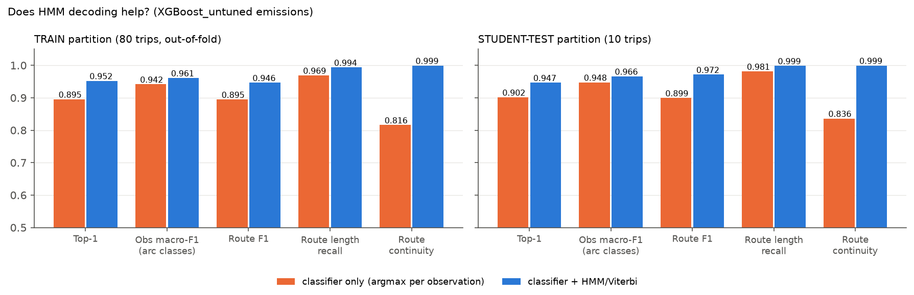
*Figure 29 – Classifier-only vs classifier + HMM [train out-of-fold, student_test].*

*Figure 30 – Per-trip Top-1 and route F1, classifier-only vs HMM [student_test].*

**Q6 – Did HMM decoding improve the final route? Yes, on every route-level measure and on almost every trip.**

* **Observation level.** Top-1 rises from 0.9015 to **0.9466** on student-test (+4.5 points, about 46 % of the
  remaining errors removed) and from 0.8954 to 0.9523 on train out-of-fold (+5.7 points). The gain comes mainly
  from the error type found in §3.4: short **reverse-direction flips** on two-way roads. A flip to the opposite
  arc for one or two observations needs a U-turn at a node. Its along-network distance is much longer than the
  1-s GPS displacement, so the transition term rejects it. Trip 00000077, which had 49 % of the classifier's
  errors, improves the most: from 0.7665 to **0.8743**.
* **Route level.** Route F1 rises from 0.8994 to **0.9715** and continuity from 0.836 to **0.9995**. Classifier-only
  routes break at about one in six arc changes, while the HMM route is connected except where we deliberately
  restart the chain. Route recall reaches 0.995 because the shortest-path expansion recovers arcs driven between
  two GPS fixes, which the classifier can never predict when no observation falls on a short arc.
* **Cost.** On the deployed pipeline (`results/hmm/pipeline_smoke_student_test.csv`), a full trip takes 50–974 ms
  end to end, including feature building and HMM decoding.

**Cases where the HMM did not help**

* **Student-test trip 00000065** (Top-1 0.8659 → 0.8633, −0.3 points). It is the only student-test trip with a
  gap above gap_s (one 210 s gap, one gap break), so the network constraint is dropped once. Its remaining errors
  are not removed by the transition model. The route F1 still rises from 0.900 to 0.986, because the
  reconstructed route is connected.
* **Train trips:** the HMM improved Top-1 on 70 trips, tied on 3 and was worse on 7. The worst drops are trip 22
  and trip 89 (−1.9 points each). Trip 22 is the most down-sampled trip (only 53 % of steps are 1 s apart).
  A likely cause: with multi-second steps the "network distance ≈ GPS distance" assumption is weaker, and
  β = 3 m then penalises legitimate turns between fixes.
* **Disconnected candidates.** 1,671 of the 1,798 chain restarts on train come from trip 54. Its reference route
  is truncated, and its GPS is far from the supplied network (median 84 m to the nearest node, Stage 1), so
  consecutive candidate sets are often unreachable from each other. Without the restart rule the decode would be forced through impossible
  transitions.
* **Route precision** increases only slightly on train (0.9031 → 0.9050), because shortest-path gap filling can
  insert a wrong detour when two consecutive decoded arcs are far apart.

## 6. Geographical visualisation using Folium

All maps are generated by our own code. `viz/folium_maps.py` (`make_trip_map`, `network_segments_near`) is the
shared map builder, used by the EDA (`eda/02_eda.py`, Figure 12) and by the route-comparison tool
`viz/make_route_maps.py`. For any trip, that tool runs the deployed pipeline (`predict_trip(use_hmm=True)`) and
draws five layers with fixed, distinguishable styles:

| Layer | Style | Source |
|---|---|---|
| Original GPS observations | blue dots, green start and red end markers | `.track` |
| Relevant road network | thin grey lines, arcs within 150 m of the track | `.nodes` / `.arcs` |
| Reference route | wide green line | `.route` (report maps only, never sent to the UI) |
| Classifier-only route | orange dashed line | `route_coords_classifier_only` |
| HMM / predicted route | red line on top | `route_coords` |

Every map has a layer control (each layer can be switched off), a fixed legend, a title
with the trip, model and route F1, and bounds fitted to the GPS track, so the extent and zoom match the trip.
Drawing the prediction on top of the wide reference line makes deviations easy to see.
`python viz/make_route_maps.py --all-student-test` writes `results/maps/<trip>_routes.html` and a PNG for all 10
student_test trips.

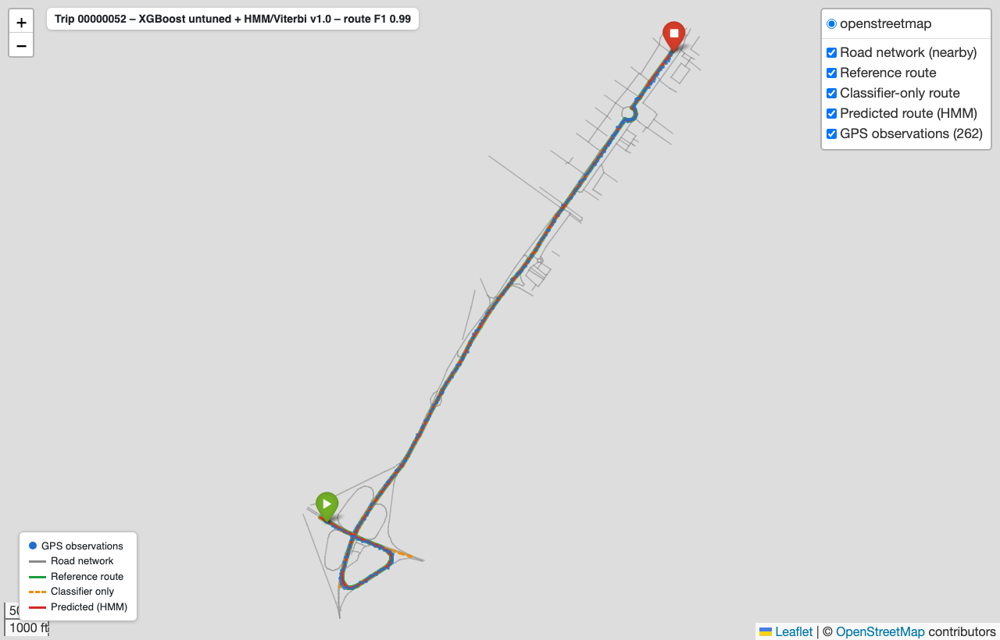
*Figure 31 – Trip 00000052 [student_test], deployed model (route F1 0.99). Blue: GPS observations, grey: nearby
network, green: reference route, orange dashed: classifier-only route, red: HMM route. Near the start (bottom
right) the classifier-only route makes a short detour onto a side arc. The HMM route follows the reference.
The background tiles did not load during this capture, but all data layers are drawn.*

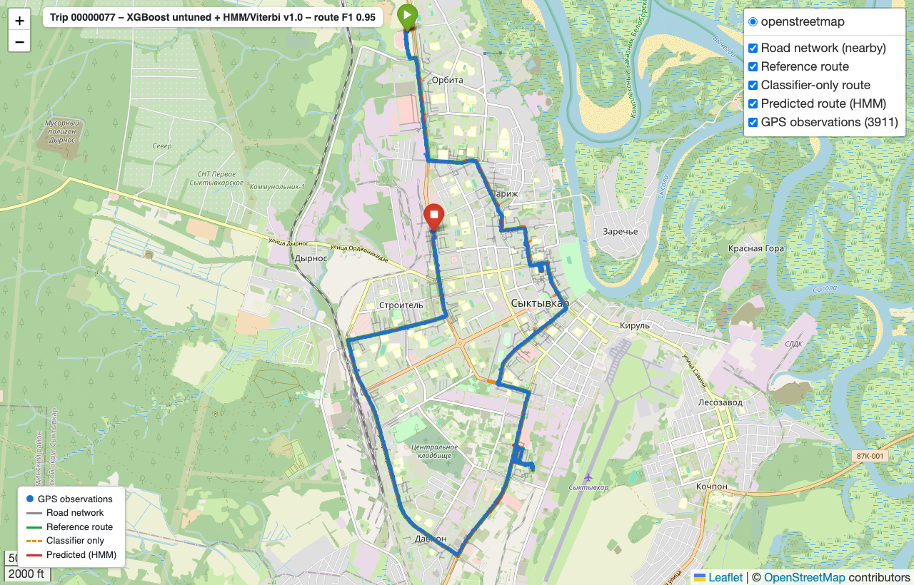
*Figure 32 – Trip 00000077 [student_test], the hardest trip (§3.4), full extent (3,911 observations, route F1 0.95).*

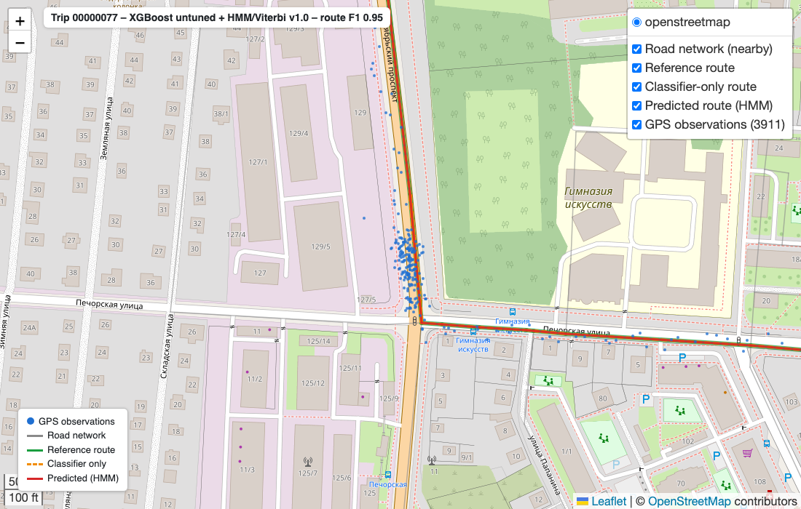
*Figure 33 – Trip 00000077 zoomed (zoom 17) on the densest cluster of observations where the classifier-only arc and
the HMM arc differ (`viz/zoom_screenshot.py`). The vehicle moves slowly (median 7 m between fixes) and the fixes
scatter across the carriageway. In this window, all 49 disagreements are reverse-direction cases: the
classifier picks the opposite arc of the same street, so the orange and red lines overlap, and the HMM keeps the
direction of travel. Against the aligned reference labels, the HMM is right on 49/49 and the classifier on 0/49.
Over the whole trip there are 861 disagreements, and 678 of them (79 %) are reverse-direction. Of all 861,
the HMM is right on 612, the classifier on 192, and neither on 57.*

Interactive versions of all ten student-test maps are in `results/maps/<trip>_routes.html`.

## 7. API, UI and deployment

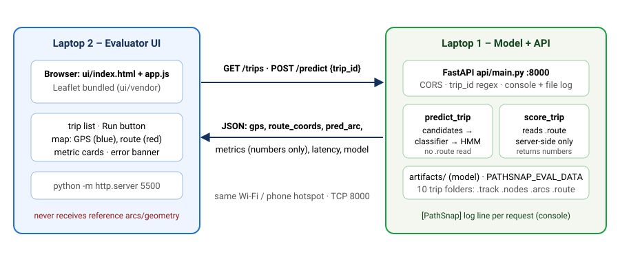
*Figure 34 – Two-laptop deployment architecture.*

**API (Laptop 1, `api/main.py`, FastAPI + Uvicorn on 0.0.0.0:8000, Swagger UI at `/docs`).**

| Method | Path | Request | Response |
|---|---|---|---|
| GET | `/health` | – | `{"status":"ok","model":{"name","version"}}` |
| GET | `/trips` | – | `{"trips":[{"trip_id","n_obs"}]}` from the folders in `PATHSNAP_EVAL_DATA` |
| POST | `/predict` | `{"trip_id":"…","use_hmm":true}` | `predict_trip` output + `metrics` + `server_latency_ms` |

* **Request handling.** A trip id must match `^[0-9A-Za-z_-]+$`, so path traversal is impossible. An unknown id
  returns 404. A pipeline exception returns 500 with its message, and the server keeps running.

* **Logging.** Each request prints one coloured line on the Laptop 1 console, e.g.
  `[PathSnap] … | client=192.168.x.x | trip=00000052 | n_obs=262 | top1=… | route_f1=… | … ms`. Full metrics are
  also written to the rotating log file `api/logs/api.log`. At start-up the console prints the trip folder,
  the number of trips found and the LAN address to enter in the UI.

* **Leakage safeguards.**
    * `predict_trip` loads the trip with `with_route=False`, so the `.route` file is never read during prediction.
    * Only `score_trip` reads the reference route, on the server, and it returns numbers only.
    * Before responding, the API removes any key that could carry reference data (`route`, `reference*`, `ref_*`).
    * `api/test_api.py` asserts for every trip that no such key is present, and the UI has no code path that draws a
    reference route.

**UI (Laptop 2, `ui/`).** A static HTML/JS/CSS page with no build step, served by `python -m http.server 5500`.
Leaflet is bundled in `ui/vendor/`, so the page works on a hotspot without internet; only the background tiles
need it. The page has:

* an API-URL field, remembered in the browser, with a connection status indicator;
* a list of the evaluation trips from `GET /trips`, and a Run button that calls `POST /predict`, with a spinner;
* a Leaflet map with the GPS points (blue), the predicted route (red), the classifier-only route when available,
  a layer control and a legend, fitted to the trip's bounds;

* metric cards for Top-1 accuracy, macro-F1, route precision, recall and F1, continuity, number of observations,
  server and total latency, and model name;

* an error banner when the API is unreachable or a request fails.

**Deployment.** `deploy/DEPLOYMENT.md` and `deploy/DEMO_CHECKLIST.md` cover the steps:

* Put both laptops on the same Wi-Fi or phone hotspot.
* Run `deploy\open_firewall.bat` once on Laptop 1.
* On Laptop 1, run `deploy\run_api.bat "<evaluator trips folder>"`.
* On Laptop 2, run `deploy\run_ui.bat http://<Laptop-1-IP>:8000`.
* Before the demo, `api/test_api.py` checks all trips end to end.

<!-- TODO(B10, at the two-laptop rehearsal): screenshot of the UI after a run (Laptop 2) -->
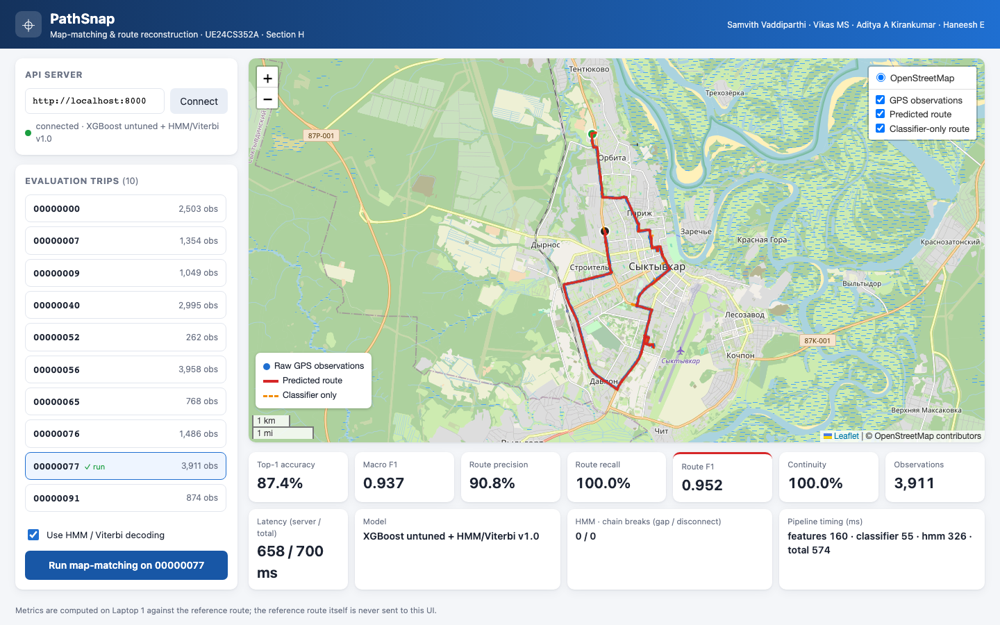
*Figure 35 – Evaluator UI after running trip 00000077 against the API, with the deployed model on the student_test
trips (single-machine run: API and UI on one laptop). Shown: the predicted route (red) and classifier-only route
(orange), and metric cards for Top-1 87.4 %, route F1 0.952, continuity 100 %, 0/0 HMM chain breaks and pipeline
timing. Replace this figure with the screenshot from the two-laptop rehearsal (Laptop 2).*
<!-- TODO(B10): screenshot of the Laptop 1 console with [PathSnap] request lines -->

## 8. Team contributions and AI-use disclosure

| Member | Contribution |
|---|---|
| Samvith Vaddiparthi (PES1UG24AM468) | Dataset inventory and data-quality checks (Stage 1, `scripts/01_inventory.py`); per-observation label alignment, candidate generation and the 25-feature design (`labels.py`, `geo.py`, `features.py`, `02_build_dataset.py`); HMM/Viterbi decoder, decoder tuning and the classifier-vs-HMM study (`hmm.py`, `07_hmm_experiments.py`); final pipeline integration and model export (`pipeline.py`, `08_export_final.py`); report §5. |
| Vikas MS (PES1UG24AM469) | Model experimentation: training and grouped 5-fold cross-validation of the eight classifiers, evaluation metrics and comparison plots (`models.py`, `metrics.py`, `03_train_models.py`, `04_plot_models.py`); Bayesian hyperparameter optimisation with Optuna and the tuned-vs-untuned comparison (`05_bayes_opt.py`, `06_plot_bayes.py`); report §3 and §4. |
| Aditya A Kirankumar (PES1UG24AM470) | Exploratory data analysis and Folium map builder (`eda/02_eda.py`, `viz/folium_maps.py`); FastAPI backend with logging and leakage safeguards (`api/`); evaluator UI (`ui/`); two-laptop deployment scripts and guide (`deploy/`); report §2.2 and §7. |
| Haneesh E (PES1UG24AM471) | Error analysis of the selected model (`analysis/error_analysis.py`) and the inference benchmark; route-comparison maps and screenshots (`viz/make_route_maps.py`, `viz/zoom_screenshot.py`); API end-to-end tests (`api/test_api.py`), demo checklist and viva preparation (`deploy/DEMO_CHECKLIST.md`, `docs/VIVA_QA.md`); report assembly and PDF build (`report/build_report.py`), §1 and §6. |

All four members reviewed the results, took part in the two-laptop rehearsal and can explain every section of the report.

**AI assistance.** AI coding assistants were used for code scaffolding, debugging and drafting parts of this
report. All experiments were run by the team on the provided data, every number and figure comes from scripts
in the repository, and every team member can explain the code and results.
<!-- TODO(team): adjust to the event's exact AI-disclosure wording; rewrite AI-drafted prose in your own words. -->
