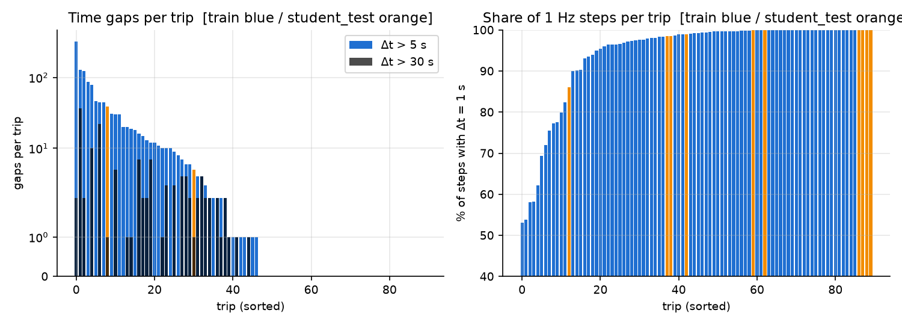
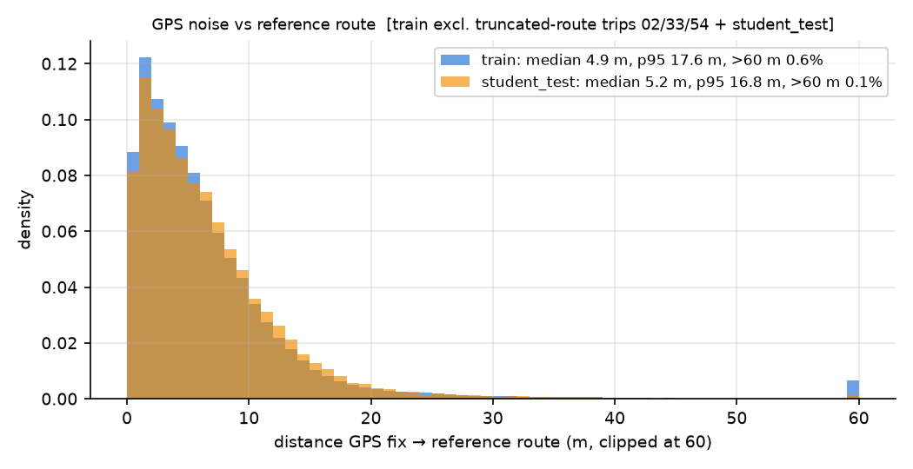
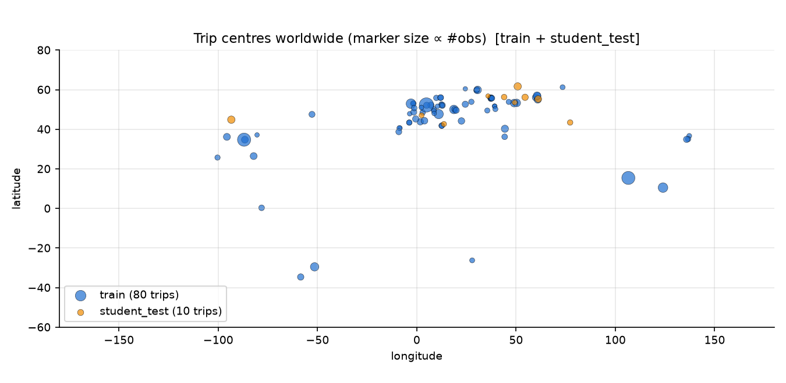
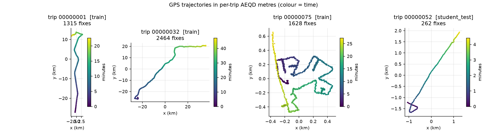

# PathSnap: Distributed Map-Matching & Route Reconstruction

## Technical Report – UE24CS352A Machine Learning Hackathon

PES University, RR Campus · Department of Computer Science and Engineering · **Section H**

| Name | SRN |
|---|---|
| Samvith Vaddiparthi | PES1UG24AM468 |
| Vikas MS | PES1UG24AM469 |
| Aditya A Kirankumar | PES1UG24AM470 |
| Haneesh E | PES1UG24AM471 |

Repository: <https://github.com/samvithvaddiparthi-ship-it/ML_hackathon->

<!-- Writing rule for every section: only numbers produced by scripts in this repo; say which partition
     (train / student_test) each result uses. Sections marked TODO(A) are filled by the ML-core stream. -->

## 1. Problem overview

<!-- TODO(team): 1 short paragraph in your own words: noisy GPS -> road arcs per observation -> route; two-laptop system. -->

## 2.2 Dataset understanding and exploratory data analysis

*Partitions: train (80 trips) and student_test (10 trips). The evaluator-test partition was never used for
development. Produced by `scripts/01_inventory.py` (Stage 1) and `eda/02_eda.py`; numbers in
`results/stage1/` and `results/eda/eda_summary.md`.*

### 2.2.1 Data structure and inventory

Each trip folder `<id>/` contains four headerless, whitespace-separated files: `.track` (lon, lat, t),
`.nodes` (lon, lat; row = node id), `.arcs` (from-node, to-node; row = arc id) and `.route` (reference arc ids
in driving order). Every trip has its own road network, so node and arc ids are local to a trip.

| Partition | Trips | GPS observations | Obs / trip (min – median – max) | Arcs / trip (median) |
|---|---|---|---|---|
| train | 80 | 208,417 | 361 – 1,529 – 19,313 | 19,527 |
| student_test | 10 | 19,160 | 262 – 1,420 – 3,958 | 13,145 |

*Figure 1 – GPS observations per trip [train + student_test].*

*Figure 2 – Raw file sizes per trip [train + student_test].*

### 2.2.2 Missing-value analysis

*Figure 3 – NaN and invalid-value counts per column [train + student_test].*

No column of any file contains NaN values, out-of-range or (0, 0) coordinates, and timestamps are strictly
increasing in every trip. No imputation is therefore needed. The data-quality problems are instead irregular
sampling, GPS jumps and imperfect reference routes (below).

### 2.2.3 Sampling and time gaps

*Figure 4 – Distribution of the sampling interval Δt (log density) [train + student_test].*

*Figure 5 – Gaps per trip and share of 1 Hz steps [train + student_test].*

The median Δt is 1 s, but the train partition has 1,216 gaps above 5 s and 133 above 30 s (student_test: 44 and 2).
Some trips are strongly down-sampled (lowest share of 1 s steps: 53 % in train, 86 % in student_test), and a
few contain gaps of hours. Three trips have non-integer timestamps.

### 2.2.4 Speed, jumps and GPS noise

*Figure 6 – Implied speed between fixes and number of implausible (> 60 m/s) jumps per trip [train + student_test].*

*Figure 7 – Distance from each GPS fix to the reference route [train without trips 02/33/54 + student_test].*

555 steps in 20 trips imply more than 216 km/h (trip 32 alone: 365), i.e. GPS outliers. Excluding three trips
whose reference route ends before the GPS track does (02, 33, 54), the median GPS-to-route distance is 4.9 m with
a 95th percentile of 17.6 m (train) and 5.2 m / 16.8 m (student_test). The reference routes also contain 14
non-contiguous steps, so they are treated as imperfect labels.

### 2.2.5 Geography, trajectories and road networks

*Figure 8 – Trip centres [train + student_test].*

*Figure 9 – GPS trajectories in per-trip metric coordinates [trips as labelled].*

*Figure 10 – Road network (grey), reference route (green) and GPS (blue) [trips as labelled].*

*Figure 11 – Network size and connectivity [train + student_test].*

Trips are spread over several continents, so all distances are computed in a per-trip azimuthal-equidistant
projection in metres. Networks range from 649 to 307,392 arcs, about 95 % of arcs have a reverse arc (two-way roads), and
networks are fragmented into 1 – 421 weakly connected components.

### 2.2.6 Folium map

*Figure 12 – Folium map of trip 00000052 [student_test]: GPS observations, road network within 150 m, reference
route, layer control and legend. Interactive version: `results/maps/eda_student_test_00000052.html`
(train example: `eda_train_00000075.html`).*

### 2.2.7 Preprocessing and feature engineering

<!-- TODO(A): how labels were aligned to the route, candidate generation (radius from §2.2.4), the features
     extracted and WHY each one (distance, heading difference, speed, gap flags, ...). -->

## 3. Model experimentation and comparison

### 3.1 Overall model comparison

<!-- TODO(A): fill from results/models/*.csv – actual numbers only; N/A with reason where not applicable. -->

| Model | Algorithm family | Key configuration | CV macro F1 | Student-test Top-1 | Route continuity | Student-test macro F1 | Log loss | Inference time |
|---|---|---|---|---|---|---|---|---|
| Model 1 | | | | | | | | |
| Model 2 | | | | | | | | |
| Model 3 | | | | | | | | |
| Model 4 | | | | | | | | |
| Model 5 | | | | | | | | |

### 3.2 Per-model analysis

<!-- TODO(A): one subsection per model, answering A (why suitable, strengths/limits), B (hyperparameters and
     initial values, loss/objective), C (student-test results, Top-1 / macro F1 / log loss, over/underfitting evidence). -->

#### 3.2.1 Model 1 – …
#### 3.2.2 Model 2 – …
#### 3.2.3 Model 3 – …
#### 3.2.4 Model 4 – …
#### 3.2.5 Model 5 – …

### 3.3 Model visualisations

<!-- TODO(A): CV macro-F1 comparison, student-test Top-1 & macro-F1 comparison, log-loss comparison,
     optional confusion matrices, loss curves ONLY for models with real epoch histories. -->

## 4. Bayesian hyperparameter optimisation

<!-- TODO(A): parameters searched, ranges/distributions, objective, number of trials, best values,
     untuned vs tuned table (CV macro F1, student-test Top-1, student-test macro F1, log loss, inference time). -->

## 5. HMM and Viterbi route reconstruction

<!-- TODO(A): hidden states, emission and transition probabilities, missing candidates / large gaps, disconnected
     segments, classifier-only vs classifier+HMM comparison (table + maps from viz/folium_maps.make_trip_map),
     cases where HMM did not help. -->

## 6. Geographical visualisation using Folium

All maps are produced by `viz/folium_maps.py` (`make_trip_map`). Layers use fixed colours: GPS observations
blue dots, nearby road network grey, reference route green, classifier-only route orange dashed and the final
(HMM) route red. Each map has a layer control, a legend, start/end markers, and bounds fitted to the trip.

<!-- TODO(A/B): insert the classifier-only vs HMM comparison map screenshot(s) for 1–2 student_test trips. -->

## 7. API, UI and deployment

* **API (Laptop 1):** FastAPI, `api/main.py`. `GET /health`, `GET /trips`, `POST /predict {trip_id}`. The
  prediction pipeline never reads the reference route. Scoring happens on the server, and the response contains
  only metric values, never reference arcs or reference geometry. Every request prints one log line on the
  Laptop 1 console and is also written to `api/logs/api.log`.
* **UI (Laptop 2):** static page in `ui/` (Leaflet bundled locally), served with `python -m http.server 5500`.
  It lists the evaluation trips, calls `/predict` and shows the GPS points, predicted route, Top-1 accuracy,
  macro F1, route precision / recall / F1, continuity, number of observations and latency.
* **Deployment:** `deploy/DEPLOYMENT.md`, `deploy/run_api.*`, `deploy/run_ui.*`, `deploy/open_firewall.bat`.

<!-- TODO(B): screenshot of the UI after a run (Laptop 2) -->
<!-- TODO(B): screenshot of the Laptop 1 console with [PathSnap] request lines -->

## 8. Team contributions and AI-use disclosure

| Member | Contribution |
|---|---|
| Samvith Vaddiparthi (PES1UG24AM468) | <!-- TODO --> |
| Vikas MS (PES1UG24AM469) | <!-- TODO --> |
| Aditya A Kirankumar (PES1UG24AM470) | <!-- TODO --> |
| Haneesh E (PES1UG24AM471) | <!-- TODO --> |

**AI assistance.** AI coding assistants were used for code scaffolding, debugging and drafting parts of the
documentation. All experiments were run by the team on the provided data, every number and figure in this report
comes from scripts in the repository, and every team member can explain the code and results.
<!-- TODO(team): adjust to the event's exact AI-disclosure wording. -->
